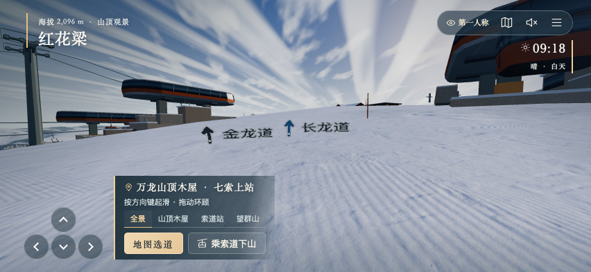
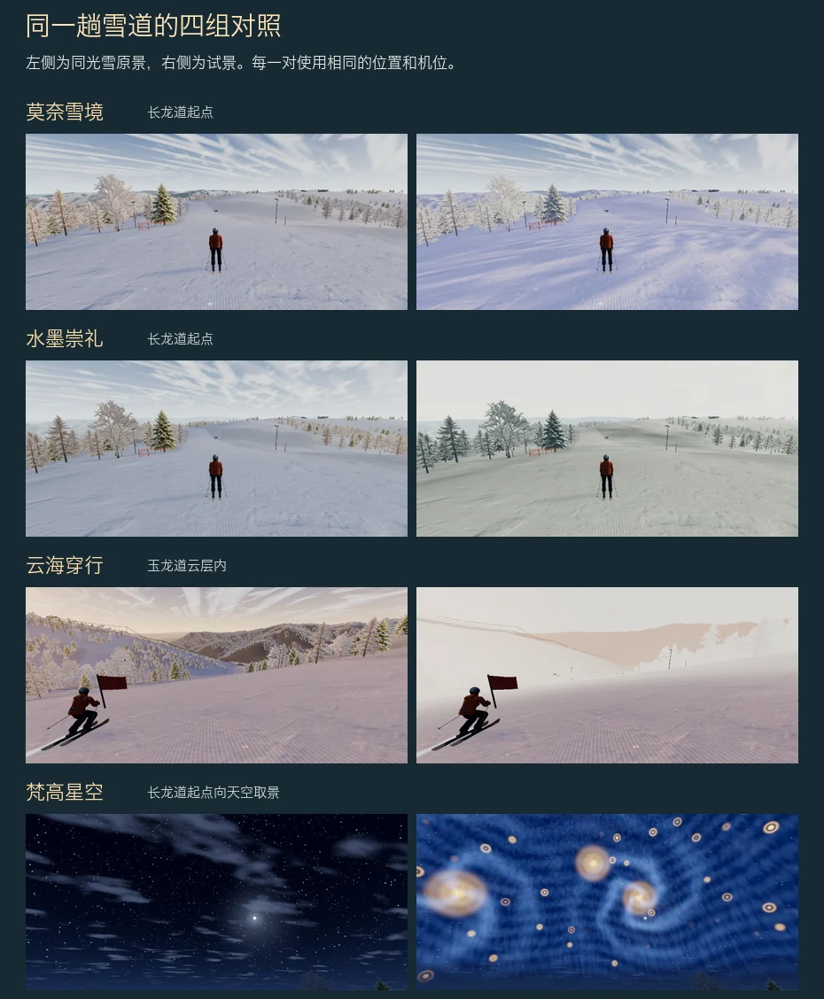
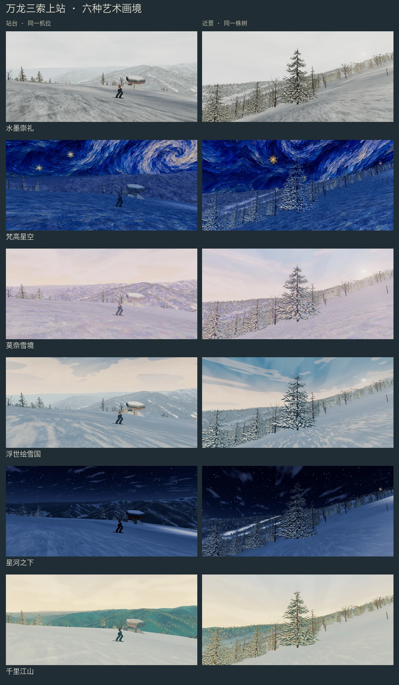

# 山脊之间 · 万龙与云顶

河北崇礼红花梁的三维滑雪网页。万龙与云顶位于山脊两侧，在同一张地形上相连。手机横屏、竖屏和电脑键盘都可以玩。[直接体验网页版 1.21.1](https://qupfile.cloudvdn.com/chongli-ski_20261126_015844.html)



首页可选择出发雪场、单板或双板、角色和雪服配色。男士、女士和约 5–6 岁的男孩、女孩有各自的身形，儿童使用短雪板和短雪杖。每次打开时，尚未手动选择的项目各自随机，选过的项目沿用上次的设置。

点「进入山顶」后，滑手停在缆车上站附近，面朝下坡。万龙正前方通往长龙道，云顶从约 2,103 米的山脊高点向前沿柳兰上段滑入芍药花。轻点一次 ↑ 后松开，雪板就会沿坡加速。也可以先原地环顾木屋、索道站和山脊，再朝雪面上标出的其他道口出发。第一次到万龙，可以先朝长龙道滑出，再向左转入金龙道。地图也可手选道口。

雪场地图默认未滑优先。点名称、长度、垂降或是否滑过可以排序，再点同一项即可倒序。路线卡上的长度和垂降对应本道，另列的全程包含后续连接段。滑行途中点选一条道，可以前往它的起点。选中当前路线时也可以继续原趟滑行。点「清除双雪场标记」可重新探索，地图内可立即撤销。累计里程、次数和滑行记录会保留。

山丹丹和翠菊花的联滑线按实际经过的连接道点亮，与对应的单道共用一枚探索标记。山丹丹由万龙顺坡通往云顶。翠菊花由云顶通往万龙，在游戏中从万龙反向进入需蹬坡。抵达山脚会自动收速并停在雪面上。拖动可让滑手与机位一起原地转向，环顾大厅与相连的酒店，查看本趟成绩，乘索道上山或重滑本线。玉龙道下端可以连入娇龙道，按钮随环顾方向提示左转、右转或转身，沿雪场前往其他索道下站。云顶雪绒花、剪秋萝一带到达三索后，可向前续滑至一索，乘坐直达山顶的缆车。山脚和缆车右下角均显示累计滑行里程、含重复滑行的雪道次数，以及双雪场探索率。山脚续滑接着同一趟累计。

落差下方的滑程按雪板实际走过的路线累计。滑出一条具名雪道时，仪表下方短暂显示这段的距离、用时和均速，约 4 秒后提示完全消失。首次完成具名雪道时会短暂显示道名和「雪场已探索」百分比，分子、分母与雪场地图一致。文字背景透明。乘缆车时可查看本趟总滑程、总用时、均速和最高时速，统计包含连接道和山脚续滑，上下站之间保持固定。

小红书公开榜分为探索率与滑行次数。玩家点「用我的进度上榜」提交成绩，次数榜的占比以返回的前 100 名滑行次数总和计算。「我的雪道占比」用个人总次数作分母，在网页也能看。旧存档按可恢复的滑行记录累计里程，已探索的每条道至少计一次。新版逐次记录重新滑入的具名雪道。

小红书发布时，公开排名需要「用户头像和昵称」授权。实景拍摄、选图和保存分别使用设备摄像头及相册权限。9.53+ 可把合成图发给站内好友；支持笔记发布的客户端可将同一张图带入图文笔记编辑器。站外渠道可先保存原图再分享。网页可使用系统图片分享或下载图片。 [小红书小工具能力清单](https://miniapp-sandbox.xiaohongshu.com/minitool/doc)

## 同趟试景

首页点「同趟试景」，在万龙「长龙道 → 玉龙道」起点停好。点「开滑」，沿 2.42 公里的雪道依次经过十五种景观。巡览按雪道上的位置换景，滑得慢就能多看一会儿。玉龙道有一段海拔 1,830–1,870 米的云层，可以从上方看云海、滑进云雾，再从云底出来。

点滑行画面上的景观名可以定格。用左右箭头或列表选景，点「原景对照」即可比较同一光雪条件下的同一帧。点「望山谷」或「望天空」换到适合该景观的构图，相机留在原地。选好可以接着滑，也可以在这个机位拍照、录像。

首页巡览预选「示例光雪」，便于白天看日晕、入夜看星河。普通滑行中也可以从「环境 → 在当前位置试景」进入，此入口优先沿用手选的时段和天气。试景只对当前体验生效，结束后回到个人环境设置。

| 试景类别 | 可选项目，按本次试验的优先级排列 |
| --- | --- |
| 自然景观 | 日照金山、云海穿行、云隙光、灯光夜场、钻石尘、晴天吹雪、月光滑雪、阵风暴雪、日晕与幻日 |
| 艺术画境 | 莫奈雪境、水墨崇礼、梵高星空、浮世绘雪国、星河之下、千里江山 |

**取舍**　浪漫主义雪原的低云构图并入云海，黄金国度与水晶世界各取山脊金边、悬浮冰晶。本轮舍去以单张成片为主的水彩冬日、主要适合索道的透纳风暴和依赖后方尾迹的星光森林。异星雪场、蒸汽波、数字矩阵、几何童话、分形幻境、超现实梦境与悬浮仙山也留在本次雪道试验之外，以保留两座雪场的地形辨识度。



打开三索专用入口，点「三索上站试景」，会从真实索道上站的固定机位进入水墨崇礼。六种艺术画境都可以点「看近树」，端详同一株树的枝条、树皮和覆雪。点「原景对照」会保留当前机位与光雪，点「回滑手机位」回到原处。[万龙三索上站试景](https://qupfile.cloudvdn.com/chongli-ski_20261126_015844.html#sansuo)



每种画境有落叶松、云杉和白桦各两种树形。近树用立体枝条和雪帽，远林用同源模型烘焙的图集。首次进入对应画境才读取它的图集与画布，缓存最近两套。莫奈和梵高各有独立雪面画布，梵高还有可环顾的星空。普通滑行和九种自然景观共用原有林带资源。小红书版把美术资源一起装入离线包，在本地按需读取。

## 本地运行

使用 Node.js 22.12 或更高版本，也支持 Node.js 20.19 及后续 20.x 版本。项目使用 npm、Vite 和 Three.js。三维场景需要支持 WebGL 2 的浏览器。

```sh
git clone https://github.com/zhoutingunl/chongli_ski.git
cd chongli_ski
npm ci
npm run dev
```

电脑浏览器打开终端打印的 Local 地址。手机与电脑连接同一 Wi-Fi 后，在手机浏览器打开 Network 地址。游戏运行时使用仓库自带的地形、影像与材质。

验证生产构建时运行以下命令。部署时将整个 `dist/` 目录作为静态站点根目录。

```sh
npm run build
npm run preview
```

## 操作

| 操作 | 手机 | 键盘 |
| --- | --- | --- |
| 从当前位置起滑 | 转向雪面上的道口，点左下方向键起滑 | 任一方向键或 WASD |
| 转弯 | 点左右方向键，或在左侧雪面拖动 | A / D 或左右方向键 |
| 压板头、压板尾 | 在左侧雪面向上、向下拖动 | I / K |
| 加速、刹车 | 按住对应按键 | W / S 或上下方向键 |
| 跳跃 | 按住「跳」蓄力，松开起跳 | 按住并松开空格 |
| 切换视角 | 右上角切第一人称和外部机位，眼形图标轮换九种机位 | V 或 C |
| 360° 环顾 | 右手拖动环顾、左手同时转弯。也可在同侧双指环顾，点指南针回正 | 鼠标拖动，或 J / L、U / O，R 回正 |
| 地图、暂停 | 右上角地图、菜单 | M、Esc |

13 条索道的上站均有本地道口指引，道名和箭头印在雪面上，未滑过的道口另有暖色和文字标记。万龙七索与主山顶共用红花梁出发区，三索从本站附近的高点出发。滑行中，临近有多条可选雪道的岔口时，雪面才会出现一组指引。每个去向显示一次道名和方向箭头，选路通过后收起。按住方向键可在进道前改道、横切或调头。手动滑行时按住加速可蹬坡。开启循线辅助并松开操作后，上坡低于 10 km/h 会自动蹬行，超过 20 km/h 收力滑行。转向、刹车或起跳会立刻接管。地图也可指定出发道口。追尾与侧视机位中，滑手依据速度和实际转弯负荷倾身。双板在弯中屈伸双腿，单板从前刃过渡到后刃时移动重心，夹克从腰部到衣领连续弯曲。首次进入采用第一人称，浏览器会记住已选择的机位。循线辅助默认开启，可以在设置中关闭并自由滑行。自动回转时，镜头沿雪道向前看，根据预期的换刃轨迹平滑跟随。第三人称保留中央横移空间，接近弯道时镜头逐渐转向。展开机位工具点「拍照」或按 P，会直接保存当前干净的雪景。需要系统操作的设备显示「保存」。暂停菜单里的「分享雪场」可预览照片、拍摄或选择实景照片并合成分享，也可播放和分享录像。山脚直接提供拍照和录像。点「录像」或按 B 可录制当前机位的游戏画面，最长 15 秒。录完可继续滑行。桌面网页发起视频下载，小红书可保存至小工具并发视频笔记，支持文件分享的浏览器可从系统菜单导出。设置提供经授权的体感转向、中英文、画质、声音、九首背景音乐和音量。时段和天气可分别手选。自动时段首次从八个时段中随机选取，随后在抵达索道上站或连续滑行满两分钟时按序推进。白天之后进入正午，再向傍晚过渡。正午也可在环境菜单中手选。自动天气会在晴、小雪和大雪之间随机平滑过渡。首次有效滑过并离开具名雪道后，地图高亮该雪道。雪道进度、滑行成绩和偏好保存在当前浏览器。

直滑会留下压痕，立刃时雪会沿弯道外侧堆起，横刹会推出雪扇。道边的软雪比道中央的压实雪更容易陷入。天气设为晴、时段设为白天后，转动视线可看到雪道和树枝积雪上的冰晶随光线闪动。

## 自动化测试

安装依赖后运行 `npm test`。测试使用 Node.js 内置的测试运行器，可以在终端离线执行。角色测试直接驱动游戏使用的三维模型，测量手套、雪鞋和杖尖在雪面上的位置。

| 测试文件 | 验证内容 |
| --- | --- |
| [navigation.test.js](test/navigation.test.js) | 核对两座雪场山顶的镜头和下坡方向，验证单、双板松键滑行、进道前连续改道、岔口路标顺序、反向蹬坡、原地转身和 64 条公众雪道的起终点信息 |
| [descent.test.js](test/descent.test.js) | 在已知坡度上比较刹车、蓄力起跳和道边陷雪，验证单板与双板自动蹬坡、玩家接管、抵达山脚后停留及重滑 |
| [descent-frames.test.js](test/descent-frames.test.js) 和 [camera-window.test.js](test/camera-window.test.js) | 用芍药花实测路线检查不同刷新率、漏帧、换道及落地时的追尾位置，验证横竖屏的回转跟随 |
| [map-routes.test.js](test/map-routes.test.js) | 按四项指标双向排序、雪道自身的长度和垂降、途中改选起点及继续滑行 |
| [piste-progress.test.js](test/piste-progress.test.js) 和 [ski-engagement.test.js](test/ski-engagement.test.js) | 两条跨场联滑线实际滑行、标记清除与撤销、旧云存档合并与累计数据 |
| [snow-terrain.test.js](test/snow-terrain.test.js) | 细雪网格与远处地表连续覆盖、移动换块和切换画质、U 型池和蘑菇道 |
| [rider.test.js](test/rider.test.js) | 对比成人与儿童雪具，测量男孩、女孩直滑、加速和左右换刃时的姿态 |
| [mountain.test.js](test/mountain.test.js) | 检查高程三角面、边界采样、雪道里程与最近点、建筑和树干碰撞，以及随包林地图的尺寸 |
| [environment.test.js](test/environment.test.js) | 检查昼夜和降雪的独立周期、晴雪光照差异与无效输入回退 |

只复现万龙选道或儿童姿态时，可以分别运行 `node --test test/navigation.test.js` 或 `node --test test/rider.test.js`。

## 小红书小工具

离线包与网页版共用雪道、滑行物理和人物模型。打包需要 Python 3、Pillow，以及命令行工具 `zip` 和 `unzip`。将官方打包技能解压到仓库上一级的 `.codex/` 目录，使校验脚本位于 `../.codex/minitool-zip-builder/scripts/audit_artifact.py`。[下载官方打包技能 1.11.1](https://fe-static.xhscdn.com/minitool/20261117152455/minitool-zip-builder-1.11.1.skill)

```sh
node scripts/build-xiaohongshu.mjs ../chongli-ski-1.8.1.zip
```

脚本先校验离线目录，再校验最终 ZIP 并检查解压完整性。小工具会在设备支持录制时提供录像入口。保存到小工具的录像可在「分享雪场」的「滑行录像」中回看或分享。[方形图标](docs/media/icon.jpg) · [竖版封面](docs/media/cover.jpg) · [儿童双板换刃游戏录像](docs/media/junior-ski.mp4)

## 源码入口

- 首页选择、输入及山顶、滑行、山脚和索道的切换集中在 [main.js](src/main.js)。
- 修改雪道走向时，从地形采样、道口连通和滑行计算三个模块入手。[mountain.js](src/mountain.js) · [navigation.js](src/navigation.js) · [simulation.js](src/simulation.js)
- 三维场景与机位由 world 组织，滑手、山体林地和度假区设施在对应模块中构建。[world.js](src/world.js) · [rider.js](src/rider.js) · [landscape.js](src/landscape.js) · [resort.js](src/resort.js)
- 同趟试景的项目排序、沿线换景、光雪混合与材质分别在 [scenery.js](src/scenery.js) 和 [scenic-materials.js](src/scenic-materials.js)。
- 地形、影像和美术素材随游戏发布。小工具另有宿主接口和轻量场景。[public/assets](public/assets) · [src/xhs](src/xhs)

## 地理与美术

近区地形约 10 公里见方，以 32 米间距采样。外围约 49 公里的高程网格间距为 240 米。游戏提供万龙、云顶各 32 条公众雪道、八条组合线路及 13 条索道。59 条公众雪道使用独立测线，柳兰、金莲花采用共用走廊，雾龙、赤龙、花苜蓿依据雪场图估绘。雾龙道可以从地图进入起点。缺少测量值的雪道宽度采用估算。冬季真彩色影像摄于 2025 年 1 月 21 日，树群分布参考 2021 年林地分类。[高程来源](https://registry.opendata.aws/terrain-tiles/) · [雪道与建筑测绘及 ODbL](https://www.openstreetmap.org/copyright) · [Copernicus Sentinel-2](https://dataspace.copernicus.eu/) · [ESA WorldCover](https://esa-worldcover.org/en)

山顶木屋、金花阁、两侧大厅与相连酒店、吊厢和吊椅按实拍特征重建。云顶 1 索南侧到花锚的约 77 米山顶连接段按冬季影像中的开放雪面拟合。角色采用本地三维模型，动作依据滑行实拍调校，双板内外腿的屈伸也参考了[高山滑雪实地运动学研究](https://doi.org/10.3389/fspor.2020.00056)。开场全景、写实树木图集、梵高星空环幕和两张油画雪面使用 ImageGen 生成。六种画境的远树图集可通过 `python3 scripts/bake-art-trees.py` 从三维树形重建。几何与摄影数据可用 `scripts/` 下的脚本重建。[万龙度假区](https://www.wlski.com/) · [云顶金花阁](https://www.secretgardenresorts.com/dinning/?lang=zh-cn) · [完整地理数据署名](public/assets/geo/mountain.json) · [美术来源与生成提示](public/assets/art/credits.txt)

## 第三方参考与许可

双板独立贴地、换刃协调和风雪受光参考了 Huisky 的 [Cold Smoke 源码](https://github.com/huiskylabs/cold-smoke/tree/7c9657b3d19d93d048a4152ccc3dbcc33b043778)（MIT，Copyright © 2026 Huisky）。[完整 MIT 许可及版权声明](docs/third-party/cold-smoke-MIT.txt)

| Cold Smoke 源码参考 | 本仓库实现 |
| --- | --- |
| [双板接触](https://github.com/huiskylabs/cold-smoke/blob/7c9657b3d19d93d048a4152ccc3dbcc33b043778/src/08j_solver.js) | [雪具与角色](src/rider.js)分别用万龙云顶的地形约束两块板的板底，压坡时让踝、膝、髋随各脚的位置屈伸。 |
| [转弯动作阶段](https://github.com/huiskylabs/cold-smoke/blob/7c9657b3d19d93d048a4152ccc3dbcc33b043778/src/06c_mocap.js) | [动作驱动](src/ski-kinematics.js)从实时侧向负载和换刃变化驱动现有骨架，儿童和成人使用各自的屈伸幅度。 |
| [山脊风雪](https://github.com/huiskylabs/cold-smoke/blob/7c9657b3d19d93d048a4152ccc3dbcc33b043778/src/11b_wind.js)及[体积光](https://github.com/huiskylabs/cold-smoke/blob/7c9657b3d19d93d048a4152ccc3dbcc33b043778/src/15_shafts.js) | [贴地雪尘](src/snow-air.js)根据迎风坡、背风坡、地形和树冠遮挡改变亮度。[光照合成](src/snow-light-shafts.js)依据地形遮住太阳的程度调整逆光辉光。支持的浏览器在自动和高画质下按场景深度合成林间光束，高画质的体积光以各轴四分之一分辨率计算。 |
| [不平地形上的预判与卸载](https://github.com/huiskylabs/cold-smoke/blob/7c9657b3d19d93d048a4152ccc3dbcc33b043778/src/08j_solver.js) | [雪面与接触响应](src/snow-terrain.js)从板前后高差计算受载变化，结合速度及雪具承压面积计算压雪与漂浮。云顶 U 型池、雪上技巧和拉链蘑菇沿现有地理路线生成细化网格，U 型池采用 [FIS 技术资料](https://medias1.fis-ski.com/pdf/2022/FS/8090/2022FS8090SLQ.pdf)的比赛段尺寸作为建模参考。野雪深度和雪包形状由程序生成。 |

本项目自行实现上述效果，使用本仓库的地形、人物和几何模型。Cold Smoke 的动作捕捉素材、视频、纹理和模型均未收入本仓库。[上游动作素材及单独许可](https://github.com/huiskylabs/cold-smoke/blob/7c9657b3d19d93d048a4152ccc3dbcc33b043778/data/mocap/CREDITS.md)
